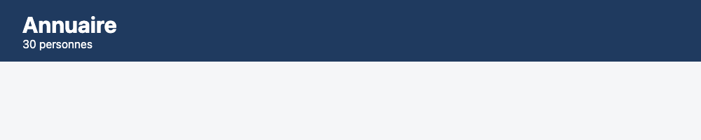
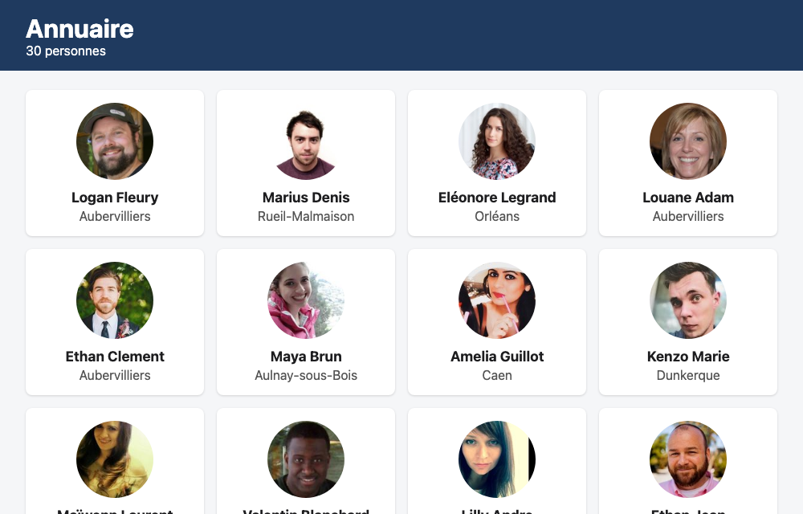
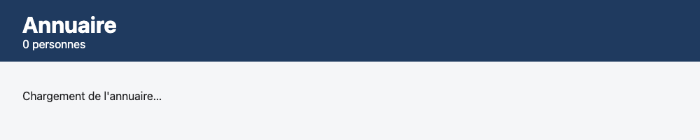
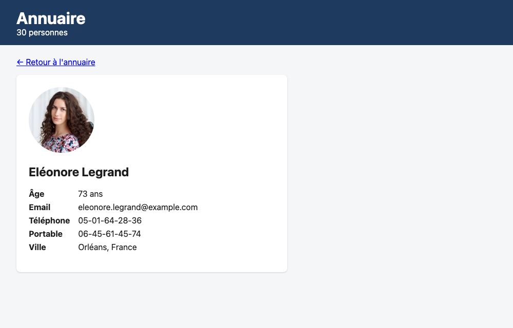
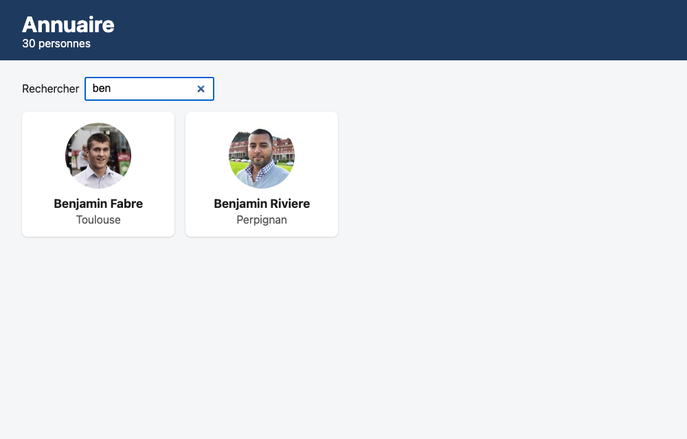
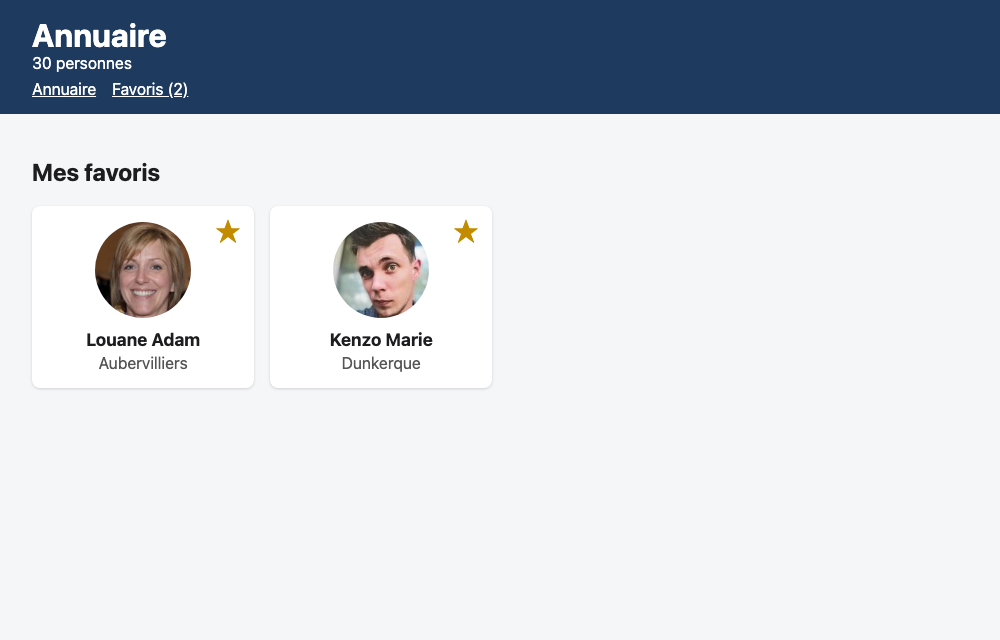
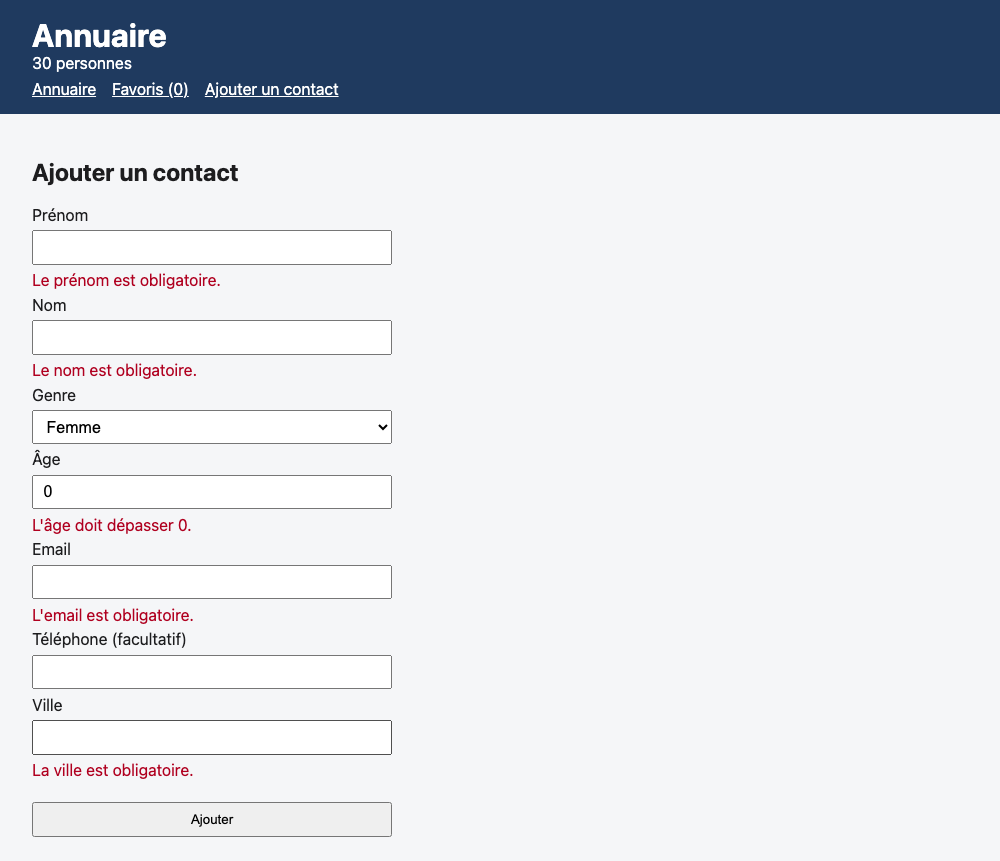
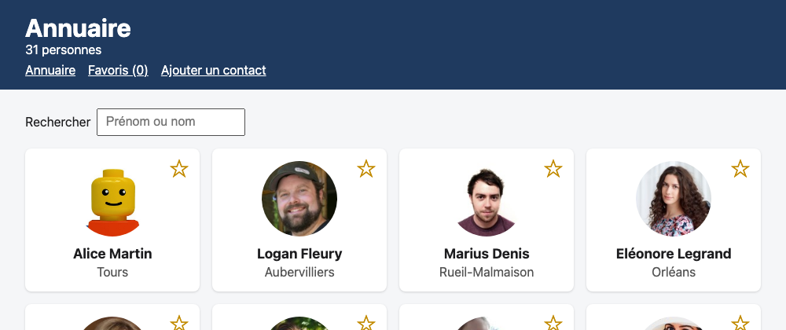
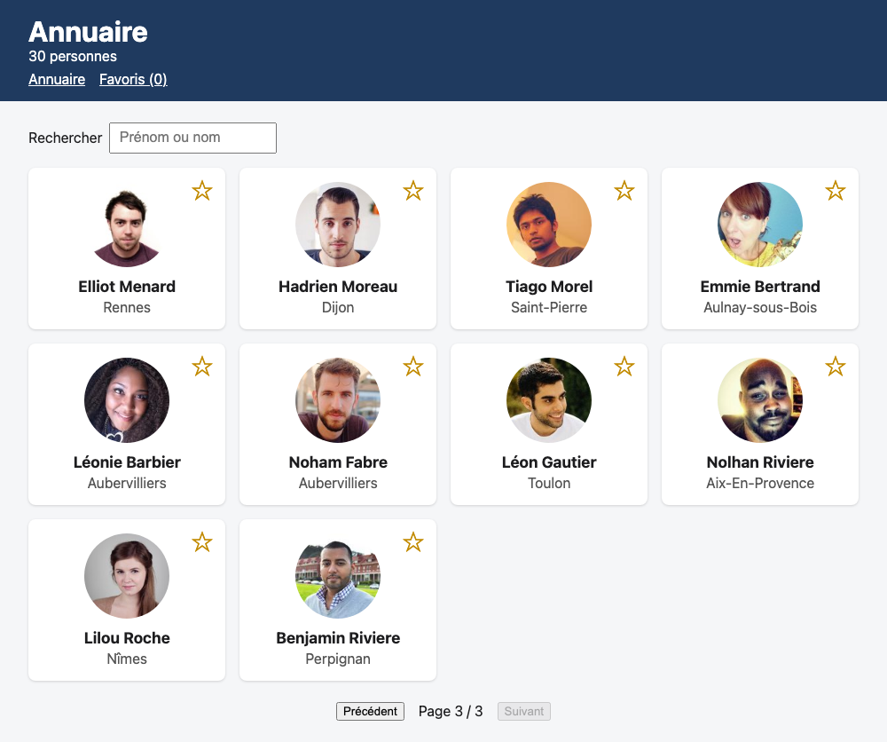
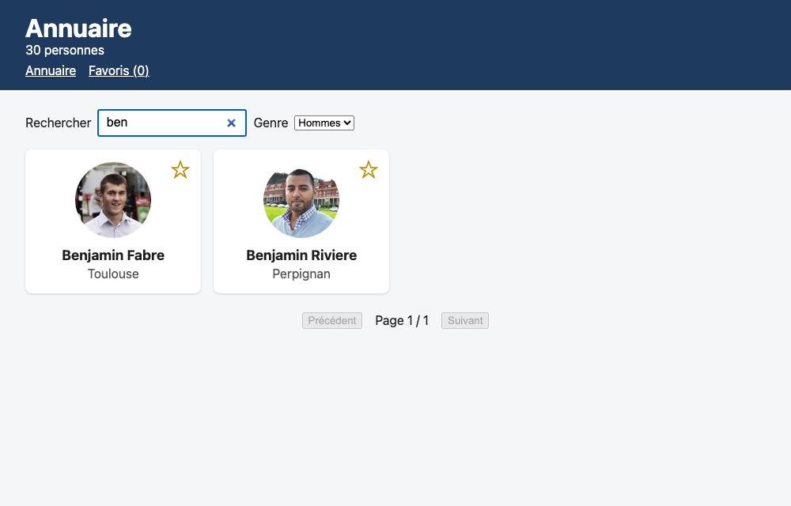

# Annuaire

Aujourd'hui, tu refais tout le module Angular d'un coup, en solo. C'est un vrai petit test pour savoir où tu en es. C'est aussi un excellent moyen de savoir sur quoi travailler si des notions restent floues.

Les étapes de cet atelier sont uniquement là pour couvrir les aspects fondamentaux qu'il est important que tu connaisses, car présent dans tous frameworks.

Je te rappelle que le but n'est pas de connaître quoi que ce soit par coeur, mais plutôt de savoir quand utiliser quels principes, et quelles sont leur conséquences.

Donc pas de panique sur une syntaxe te dérange. Panique plutôt si le concept te semble complètement flou 🤭

Ta mission : créer un annuaire de 30 fausses personnes, servies par l'API [randomuser.me](https://randomuser.me). Une liste en cartes, une fiche par personne, une recherche et des favoris. Et tu pars de zéro.

## Démarrer

Ce dépôt te donne deux choses : ce README, et `people-backup.json`, la roue de secours (on en parle juste après).

Clone-le sous le nom `annuaire-sujet` :

```bash
git clone https://github.com/peacepilou/annuaire.git annuaire-sujet
```

Ton app, tu la crées **à côté** de ce dossier, pas dedans (ng new = new git repo)

### Avant de commencer

Ouvre l'adresse de l'API dans ton navigateur :

```text
https://randomuser.me/api/?seed=cda2&results=30&nat=fr
```

Tu vois un gros objet JSON. Prends cinq minutes pour le lire : tout le TP repose dessus. Le `seed=cda2` fait que toute la classe reçoit les **mêmes** 30 personnes, à chaque appel. Pas mal !!

### Si l'API casse

Ça arrive. Le fichier `people-backup.json` contient exactement la même réponse, tirée avec le même `seed`. Même forme, mêmes personnes : outre ton fetch API, le reste de ton code ne bouge pas.

## Les règles

- **Avance étape par étape.** Chaque étape sert de fondation à la suivante.
- **Un commit par étape**, du genre `step 3: show the people as cards`. À la fin, tu compares avec la correction, commit par commit.
- **C'est toi qui écris le code.** Tu pourras bientôt laisser une IA écrire complètement du Angular pour toi, mais ta maîtrise n'est pas encore suffisante pour le faire. Et c'est juuustement un bel exercice pour ça !

Et la règle d'or du jour : **la liste se charge une seule fois, dans le service.** Toute la classe passe par la même connexion : chaque élève appelle l'API une fois, au démarrage de son app.

---

## Le socle : étapes 1 à 7

Chaque étape montre une capture de la correction. Ça te permet de mesurer directement "ok c'est ça que je dois faire"

### Étape 1 · Créer l'app

Allez à toi mon petit mousquetaire.

Crée l'app `annuaire`, sans configuration pour l'IA, et remplace la page de démo d'Angular par un en-tête « Annuaire ».

**Ce que tu dois voir :** sur `http://localhost:4200`, le titre « Annuaire », et plus rien de la page d'Angular.


### Étape 2 · Le service qui charge les 30 personnes

D'abord, les types :

- `Person` : une personne, avec seulement les champs que tu vas afficher.
- `PeopleResponse` : la réponse entière de l'API. Regarde bien où est rangé le tableau.

Ensuite, un service qui charge les 30 personnes, une seule fois, et qui sait dire où il en est : en train de charger, en erreur, ou prêt.

Affiche le nombre de personnes sous le titre. Et copie `people-backup.json` dans `public/` dès maintenant.

**Ce que tu dois voir :** « 30 personnes » sous le titre. Dans l'onglet Réseau des outils de développement, **une seule** requête vers `randomuser.me`.



### Étape 3 · La liste en cartes

La page d'accueil affiche une carte par personne : sa photo, son nom, sa ville. La carte est un composant à part.

Pendant le chargement, la page affiche « Chargement de l'annuaire… ». Si l'appel rate : « L'annuaire est indisponible. Réessaie dans un instant. »

| Ce que tu vérifies                                        | Résultat attendu                                          |
| --------------------------------------------------------- | --------------------------------------------------------- |
| La page d'accueil                                         | 30 cartes, avec photo, nom et ville                       |
| La première carte                                         | Logan Fleury, Aubervilliers                               |
| Onglet Réseau en « Slow 4G », puis recharge               | « Chargement de l'annuaire… », puis les cartes            |
| Dans le service, `randomuser.me` devient `randomuser.mee` | Le message d'erreur, et aucune carte (remets l'adresse !) |





### Étape 4 · La fiche d'une personne

Un clic sur une carte ouvre la fiche de la personne, sur `/personnes/:id` : photo, nom, âge, email, téléphones, ville, et un lien pour revenir à l'annuaire.

Attention au piège : l'API randomuser.me n'a **pas** d'adresse pour une seule personne. Donc pas de nouvel appel pour la fiche : les 30 personnes, ton service les a déjà chargées à l'étape 2. La fiche va chercher la bonne dans cette liste, grâce à l'`id` lu dans l'adresse.

Et pense au F5 sur une fiche : l'app redémarre, et pendant le chargement la liste est encore vide. Ta fiche ne doit pas conclure trop vite que la personne n'existe pas.

| Ce que tu vérifies                             | Résultat attendu                                                                      |
| ---------------------------------------------- | ------------------------------------------------------------------------------------- |
| Un clic sur Eléonore Legrand                   | L'adresse devient `/personnes/1c36fcb0-…`, avec eleonore.legrand@example.com, Orléans |
| Retour, puis un clic sur une autre carte       | Sa fiche, et aucune nouvelle requête vers `randomuser.me` dans l'onglet Réseau        |
| F5 sur une fiche                               | La fiche revient, après « Chargement de l'annuaire… »                                 |
| `http://localhost:4200/personnes/n-existe-pas` | « Personne introuvable »                                                              |



### Étape 5 · La recherche

Au-dessus des cartes, un champ « Rechercher » qui filtre la liste à chaque lettre tapée, sur le prénom et le nom, majuscules ou pas.

| Tu tapes     | Résultat attendu                                  |
| ------------ | ------------------------------------------------- |
| `ben`        | 2 cartes : Benjamin Fabre, Benjamin Riviere       |
| `BEN`        | Les deux mêmes                                    |
| `fabre`      | 2 cartes : Benjamin Fabre, Noham Fabre            |
| `benjamin f` | 1 carte : Benjamin Fabre                          |
| `xyz`        | « Aucune personne ne correspond à ta recherche. » |
| Champ vidé   | Les 30 cartes reviennent                          |



### Étape 6 · Les favoris

Chaque carte a une étoile, ☆ ou ★, qui s'allume et s'éteint au clic. Une page `/favoris` n'affiche que les favoris, et l'en-tête montre « Annuaire » et « Favoris (2) », avec le nombre à jour. Les favoris survivent à un F5.

| Ce que tu vérifies                                           | Résultat attendu                              |
| ------------------------------------------------------------ | --------------------------------------------- |
| Clic sur l'étoile de Louane Adam                             | ★, « Favoris (1) », et tu restes sur la liste |
| Étoile sur Kenzo Marie, puis « Favoris »                     | Les cartes de Louane Adam et Kenzo Marie      |
| F5 sur `/favoris`                                            | Toujours les deux                             |
| Clic sur ★ depuis `/favoris`                                 | La carte disparaît de la page                 |
| Plus aucun favori sur `/favoris`                             | Un message : aucun favori pour l'instant      |
| Application › Local Storage                                  | Une clé `favorites`, avec un tableau d'uuid   |
| Étoile sur Ethan Clement trouvé par `ethan`, puis champ vidé | Son étoile est toujours pleine                |




### Étape 7 · Ajouter un contact

Une page `/ajouter`, avec un formulaire validé : prénom (obligatoire, 2 caractères au moins), nom (obligatoire), genre, âge (entre 1 et 120), email (obligatoire, au bon format), téléphone (facultatif), ville (obligatoire).

Une fois envoyé, le contact s'ajoute en tête de l'annuaire, et tu arrives sur sa fiche. Comme photo, prends `https://randomuser.me/api/portraits/lego/1.jpg`.

| Ce que tu vérifies                  | Résultat attendu                                         |
| ----------------------------------- | -------------------------------------------------------- |
| « Ajouter » avec le formulaire vide | Un message sous chaque champ obligatoire, et on reste là |
| Prénom `A`, email `pas-un-email`    | « 2 caractères au moins. », et l'email refusé            |
| Un contact valide                   | Sa fiche s'ouvre, « 31 personnes », sa carte en premier  |
| F5                                  | Il a disparu : « 30 personnes »                          |





La dernière ligne est normale : randomuser.me n'enregistre rien, et ton contact ne vit que dans le signal du service, le temps que la page reste ouverte.

---

## Les bonus

Le socle tourne ? Choisis ceux qui te tentent, dans l'ordre que tu veux.

### Bonus · La pagination

10 cartes par page, avec « Précédent », « Suivant » et « Page 1 / 3 ».

| Ce que tu vérifies          | Résultat attendu                      |
| --------------------------- | ------------------------------------- |
| La première page            | 10 cartes, « Précédent » désactivé    |
| Deux clics sur « Suivant »  | « Page 3 / 3 », « Suivant » désactivé |
| `ben` tapé depuis la page 3 | « Page 1 / 1 » et les deux Benjamin   |



### Bonus · Le filtre par genre

Une liste déroulante « Tous / Femmes / Hommes », qui se combine avec la recherche.

| Tu choisis            | Résultat attendu                                  |
| --------------------- | ------------------------------------------------- |
| Femmes                | 12 personnes                                      |
| Hommes                | 18 personnes                                      |
| Hommes, et `ben` tapé | Les deux Benjamin                                 |
| Femmes, et `ben` tapé | « Aucune personne ne correspond à ta recherche. » |



### Bonus · Un guard sur les favoris

Sans aucun favori, `/favoris` ne sert à rien : un guard renvoie vers l'annuaire.

| Ce que tu vérifies                           | Résultat attendu      |
| -------------------------------------------- | --------------------- |
| Aucun favori, `/favoris` tapé dans l'adresse | Retour sur l'annuaire |
| Un favori, puis « Favoris »                  | La page s'ouvre       |

---

Bon courage, et pense à tes commits !
